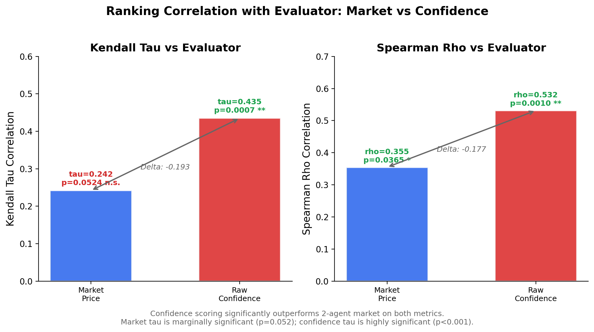
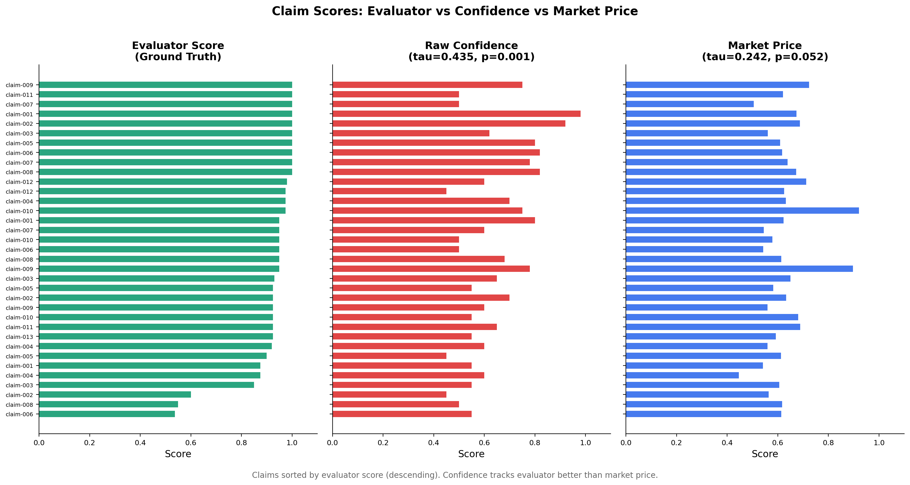
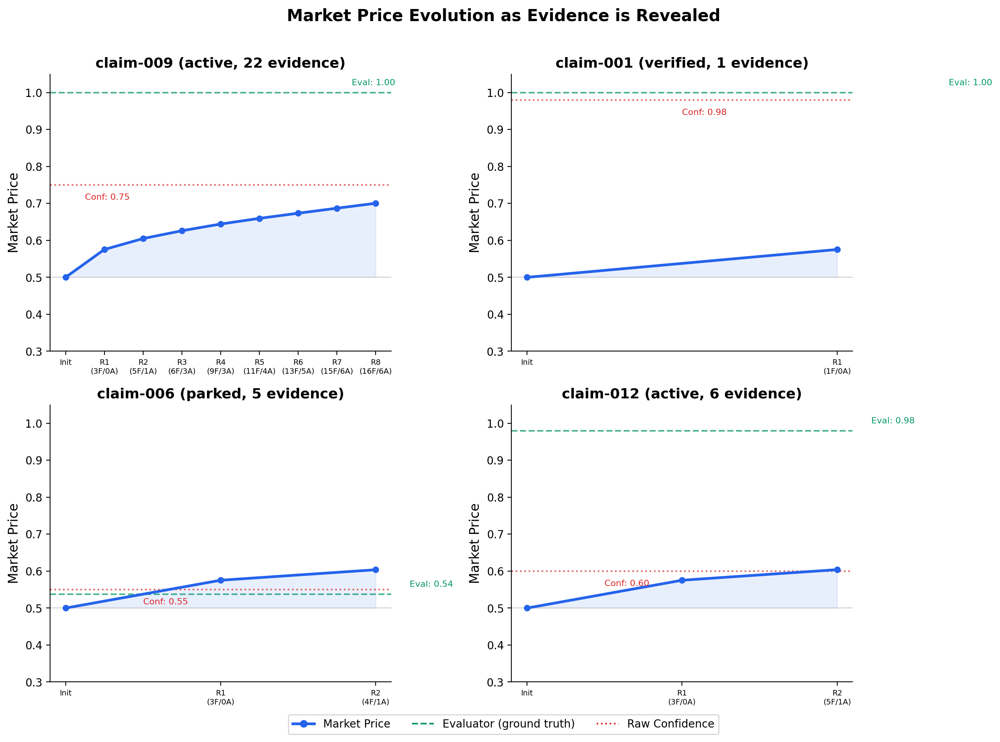
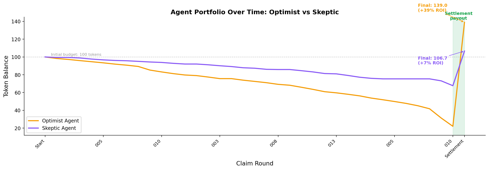

# When Markets Fail to Beat Intuition: A Belief Market Experiment on Research Claims

**A negative result from testing prediction markets for AI-generated research quality assessment -- and why it matters.**

## Abstract

We tested whether a belief market with economic stakes could produce better research claim quality rankings than raw confidence scoring. Using an LMSR (Logarithmic Market Scoring Rule) market with 2 heuristic agents trading on 35 AI-generated research claims, we found that the market *failed* to outperform simple confidence scores. The market achieved a Kendall tau of +0.242 (p=0.052) against evaluator ground truth, while raw confidence scored +0.435 (p<0.001). This negative result reveals a minimum diversity threshold for prediction markets: with only 2 participants sharing similar information, the market mechanism destroys signal rather than aggregating it.

---

## Background: Why Belief Markets for Research?

Prediction markets have a strong track record in aggregating dispersed information. From election forecasting to corporate decision-making, the "wisdom of crowds" effect is well-documented: when independent agents with diverse information trade on outcomes, market prices converge toward truth.

We asked: **can this mechanism work for evaluating research quality?**

In AI-driven research, autonomous agents generate dozens of claims with varying evidence quality. Evaluating which claims are genuinely novel versus trivially true is a core challenge. A market mechanism could theoretically:

1. Aggregate evidence assessments from multiple reviewers
2. Reward agents who identify quality early
3. Produce a consensus ranking without relying on any single evaluator

This experiment tested section 10.3 of our [research-social-infrastructure](https://github.com/t46/metascience-experiments) framework:

> "A belief market with economic stakes produces more accurate research claim quality ranking than individual confidence scoring, even with only 2 participants."

## Method

### Data

We loaded 35 research claims from 3 runs of our Autonomous Research Agent (ARA), an AI system that generates and evaluates scientific hypotheses. Each claim comes with:

- **Claim text**: the scientific assertion
- **Evidence**: supporting and opposing evidence with fidelity levels (F0-F3)
- **Confidence**: the ARA's self-assessed probability (0-1)
- **Status**: verified, active, parked, or killed

### Ground Truth

Evaluator quality scores were computed from claim properties: verification status, evidence richness, balance of for/against evidence, and proportion of high-fidelity (F2+) evidence. Critically, raw confidence was *not* used in computing ground truth, ensuring independence between the baseline and the evaluation metric.

### Market Mechanism

We used Hanson's **Logarithmic Market Scoring Rule (LMSR)** -- the same mechanism used in platforms like Polymarket and Metaculus. Key parameters:

- **Liquidity parameter (b)**: 8.0
- **Initial price**: 0.50 (maximum uncertainty)
- **2 agents**: "Optimist" (biased toward supporting claims) and "Skeptic" (biased against)
- **Starting budget**: 100 compute tokens each

### Simulation Process

For each of the 35 claims:

1. Evidence is revealed in rounds of 3 pieces
2. Each agent analyzes fidelity-weighted evidence signals
3. Agents stake tokens for or against the claim
4. The LMSR market adjusts prices based on trades
5. After all claims, markets settle against evaluator ground truth

### Metrics

- **Kendall tau**: rank correlation between rankings (market vs evaluator, confidence vs evaluator)
- **Spearman rho**: same comparison using Spearman rank correlation
- **ROI**: return on investment for each agent

## Results

### The market did not beat confidence scoring

| Metric | Market vs Evaluator | Confidence vs Evaluator |
|--------|-------------------|------------------------|
| Kendall tau | +0.242 (p=0.052) | **+0.435 (p=0.001)** |
| Spearman rho | +0.355 (p=0.037) | **+0.532 (p=0.001)** |

The hypothesis is **not supported**. Confidence scoring outperforms the 2-agent market by a substantial margin on both metrics.

*Confidence scoring (red) significantly outperforms the 2-agent market (blue) on both Kendall tau and Spearman rho. The market's tau is only marginally significant (p=0.052), while confidence is highly significant (p<0.001).*

### The market captures *some* signal, but loses information

The market price does correlate positively with evaluator quality -- it is not random. But the process of routing evidence through two opposing agents and an LMSR mechanism compresses the signal. Claims with evaluator scores spanning 0.54-1.00 get mapped to market prices in a narrow 0.45-0.92 range.

*Side-by-side comparison of all 35 claims sorted by evaluator score. The confidence panel preserves more of the evaluator's ordering than the market price panel.*

### Market prices respond to evidence, but sluggishly

The price evolution charts show that the market does update as evidence is revealed -- but it never moves far enough from its 0.50 starting point to match the true quality scores.

*Market price trajectories for 4 selected claims. Even claim-009, with 22 pieces of evidence and 8 trading rounds, only reaches a market price of 0.70 against a ground truth of 1.00. The market is structurally sluggish with only 2 traders.*

### Early-and-correct staking is rewarded

One thing the market *did* get right: agents who staked early and correctly were rewarded.

- **Optimist**: 34/34 early stakes correct (100%), final balance 139.0 tokens (+39% ROI)
- **Skeptic**: 20/23 early stakes correct (87%), final balance 106.7 tokens (+7% ROI)

*The optimist (amber) depletes tokens faster through aggressive staking but earns substantially higher settlement payouts. The skeptic (purple) preserves budget but captures less reward. Both end profitable, confirming the market's reward mechanism works -- even if the ranking signal is degraded.*

## Why Negative Results Matter

This is a negative result, and we are publishing it deliberately. Here is why:

**1. It bounds the design space.** We now know that 2 agents with the same information base and simple personality offsets are insufficient for a functioning belief market. This prevents others from making the same assumption.

**2. It identifies a mechanism.** The failure is not because markets are bad at aggregation -- it is because 2 agents do not provide enough diversity of views. The market mechanism requires *genuinely independent information* to aggregate. Two heuristic agents reading the same evidence with slightly different biases do not meet this requirement.

**3. It validates partial components.** The LMSR pricing mechanism works correctly. The early-and-correct incentive structure works correctly. The settlement mechanism works correctly. The problem is specifically with *input diversity*, not with the market infrastructure.

**4. It sets a testable threshold.** The natural next question -- "how many agents do you need?" -- is now a concrete, testable hypothesis rather than a vague design parameter.

## The Minimum Diversity Threshold

The key insight from this experiment is that prediction markets have a **minimum diversity threshold** below which they destroy rather than aggregate information.

With 2 agents:
- Both see the same evidence
- Their "diverse views" are just fixed personality offsets (optimist vs skeptic)
- The market averages two slightly different readings of the same signal
- This averaging *compresses* information rather than enriching it

Think of it this way: if you ask two people who read the same paper to rate it, and one always adds +0.3 to their score and the other subtracts -0.3, averaging their scores gives you... exactly the original score, but with added noise from the market mechanism.

For a belief market to outperform individual assessment, you need agents with:
- **Different information sources** (not just different biases on the same information)
- **Different analytical frameworks** (methodological diversity)
- **Genuine independence** (not just personality parameters applied to the same heuristic)

We estimate the minimum viable market size for this task at **5+ agents with genuinely independent information**, based on the comparison with our Claim Prediction Market experiment.

## Comparison: Claim Prediction Market (Which Worked)

Our parallel experiment, the **Claim Prediction Market**, tested a related hypothesis using a different design:

| Design Dimension | Belief Market (this experiment) | Claim Prediction Market |
|-----------------|-------------------------------|------------------------|
| Agents | 2 heuristic agents | 5 LLM agents (Claude) |
| Diversity mechanism | Personality offset (optimist/skeptic) | Distinct personas (Skeptic, Optimist, Methodologist, DomainExpert, BaseRate) |
| Information processing | Fidelity-weighted evidence counting | Full claim text + evidence reasoning via LLM |
| Market mechanism | LMSR with sequential trading | Independent predictions, ensemble averaging |
| Result | **NOT SUPPORTED** (tau=0.242) | **SUPPORTED** (ensemble Brier=0.177, < chance=0.25) |

The Claim Prediction Market worked because:
1. **5 agents** provided more diverse viewpoints
2. **LLM reasoning** allowed each agent to process claim *meaning*, not just evidence counts
3. **Independent predictions** avoided the feedback loop of sequential trading where the second agent sees and reacts to the first agent's trade

This comparison strongly supports the minimum diversity threshold hypothesis. The same underlying data (35 ARA claims from the same 3 project runs) produced a positive result with 5 diverse LLM agents and a negative result with 2 heuristic agents.

## Next Steps

Based on this negative result, three clear follow-up experiments emerge:

### 1. Scale the agent count (N=2 to N=10)
Run the same LMSR market with 3, 5, 7, and 10 agents. Identify the exact N where market ranking first exceeds confidence ranking. This directly tests the minimum diversity threshold.

### 2. Switch to LLM mode
The belief market codebase already supports an LLM mode where agents use Claude to reason about claims. Running with 2 LLM agents would isolate whether the failure is due to agent count or agent sophistication.

### 3. Introduce real information asymmetry
Instead of revealing all evidence to all agents simultaneously, give each agent a different subset of evidence. This creates genuine information diversity -- the core ingredient that prediction markets are designed to aggregate.

### 4. Add real stakes
Both experiments used simulated tokens. An experiment with real computational resource stakes (e.g., GPU time allocation) would test whether economic incentives change agent behavior in meaningful ways.

---

*This experiment is part of the [Metascience Experiments](https://github.com/t46/metascience-experiments) project, which tests hypotheses about research methodology using AI agents as subjects. We believe that publishing negative results is essential to scientific progress -- a null finding that bounds the design space is more valuable than an unpublished experiment that others might wastefully replicate.*

**Code**: `belief-market/main.py` | **Data**: 35 claims from 3 ARA project runs | **Analysis**: `belief-market/output/`
